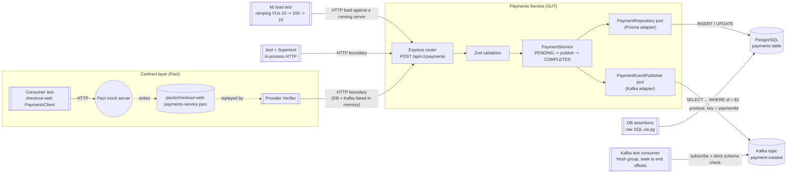

# Payments Test Lab

A minimal **Payments Service** (Node.js 20+ / TypeScript / Express 5 / Prisma / PostgreSQL / Kafka) wrapped in five test layers:

| Layer | Tool | What it proves | Needs infra? |
|---|---|---|---|
| Contract (consumer) | Pact `PactV3` | The `checkout-web` client works against the API shape it expects; writes `pacts/*.json` | No |
| Contract (provider) | Pact `Verifier` | The real Express app honours every consumer interaction | No (in-memory adapters) |
| API + DB | Jest + Supertest + `pg` | HTTP status/body are correct, and **Postgres holds exactly what was sent** (checked with raw SQL) | Postgres + Kafka |
| Kafka events | Jest + kafkajs test consumer | `payment-created` is emitted once, keyed by `paymentId`, with a strict schema and no token leak | Postgres + Kafka |
| Load | k6 | p95/p99 latency and error rate hold through a 10× VU spike | Running service |

## Architecture: test layers around the SUT



**Boundaries:** Pact and Supertest exercise the **HTTP boundary**, raw-SQL assertions check the **persistence boundary**, the Kafka test consumer checks the **messaging boundary**, and k6 checks **non-functional behaviour** (latency and errors under load) of the whole running process. Because the service depends only on the `PaymentRepository` and `PaymentEventPublisher` ports, each layer can use real or fake adapters as it needs.

## Project layout

```
docker-compose.yml           Postgres 16, Zookeeper, Kafka (cp 7.6), kafka-init (topic), optional kafka-ui
prisma/schema.prisma         Payment model + PaymentStatus enum
prisma/migrations/           SQL migration
src/
  app.ts                     Express app factory (pure, injectable)
  container.ts               Composition root: real Prisma + Kafka adapters
  server.ts                  Entry point with graceful shutdown
  kafka/kafka-producer.ts    Reusable idempotent JSON producer
  payments/                  schema, service, routes, events, Prisma repo, Kafka publisher
  http/error-handler.ts      400 / 413 / 503 / 500 mapping
tests/
  api/                       Component test: HTTP + DB assertions
  kafka/                     Event verification
  contract/consumer|provider Pact
  helpers/ support/          pg helpers, Kafka test consumer, factories, in-memory fakes
load/load-test.js            k6 spike test
```

## Quick start

Prerequisites: **Docker**, **Node.js 20+**, and **k6** (or run k6 with Docker, see below).

### 1. Install and configure

```bash
npm install
```

```bash
cp .env.example .env
```

On Windows PowerShell, use `Copy-Item .env.example .env` instead. The defaults already match `docker-compose.yml`.

### 2. Start the infrastructure

```bash
npm run infra:up
```

This starts Postgres and Kafka, waits for their health checks, and then runs `kafka-init` to create the `payment-created` topic (3 partitions). To browse topics in a UI at http://localhost:8080:

```bash
docker compose --profile tools up -d kafka-ui
```

### 3. Apply the database migration

```bash
npm run db:migrate
```

### 4. Run the service

```bash
npm run dev
```

```bash
curl -i -X POST http://localhost:3000/api/v1/payments -H "Content-Type: application/json" -d '{"userId":"user_42","amount":100.50,"currency":"USD","paymentMethodToken":"tok_123"}'
```

Expected response: `201 Created` with `{"paymentId":"<uuid>","status":"COMPLETED","amount":100.5,"currency":"USD"}`.

## Running each test layer

| Command | Layer |
|---|---|
| `npm run test:contract` | Pact consumer (writes the pact) and then provider verification. Needs no infra. |
| `npm run test:api` | API + Postgres assertions |
| `npm run test:kafka` | `payment-created` event verification |
| `npm run test:all` | All of the above |
| `npm run test:load:smoke` | k6: 2 VUs for 30 s (sanity check) |
| `npm run test:load` | k6: full spike profile (about 4 minutes) |

The service must be running (`npm run dev` or `npm run build && npm start`) for k6.

**k6 without installing it** (Docker Desktop on Windows or macOS):

```bash
docker run --rm -i -e BASE_URL=http://host.docker.internal:3000 grafana/k6 run - < load/load-test.js
```

The k6 thresholds fail the run if `http_req_failed >= 1%`, `p95 >= 500ms`, `p99 >= 1000ms`, or fewer than 99% of payments come back `COMPLETED`. A JSON summary is written to `load-summary.json`.

### Pact Broker (optional)

Set `PACT_BROKER_BASE_URL` and `PACT_BROKER_TOKEN`. The provider test then fetches pacts using consumer version selectors (`mainBranch` and `deployedOrReleased`), and it publishes verification results when `CI=true`.

## Design notes

- **Money:** the column is `NUMERIC(12,2)`. The service converts the amount to a decimal string before saving it, and the event carries `amount` as a string (`"100.50"`), so floating point never touches money at rest or in transit.
- **Validation is strict:** unknown fields, more than 2 decimal places, lower-case currency codes and malformed tokens are all rejected with a 400 error that lists the problem fields.
- **Failure path:** if the Kafka publish fails, the payment is marked `FAILED` and the API returns `503 EVENT_PUBLISH_FAILED`, so the database never says `COMPLETED` for a payment that downstream consumers never heard about. The API tests cover this path.
- **No PCI leakage:** `paymentMethodToken` is redacted in logs and is never put in the event. The Kafka test enforces this.
- **Producer:** idempotent, `acks=all`, keyed by `paymentId`, so events for one payment stay ordered on one partition.
- **Deterministic Kafka assertions:** each test consumer uses a fresh group and seeks to the end offsets captured *before* the test acts, so it sees only new messages and is not affected by group-join timing.
- **Known trade-off / next step:** saving to the DB and publishing to Kafka is a *dual write* that is not atomic (the process could crash between the two). In production, use a **transactional outbox** (write the event to an `outbox` table in the same DB transaction and relay it to Kafka with a poller or Debezium). This lab keeps it synchronous to match the spec.

## Teardown

```bash
npm run infra:down
```

This stops the containers and deletes the Postgres volume.
